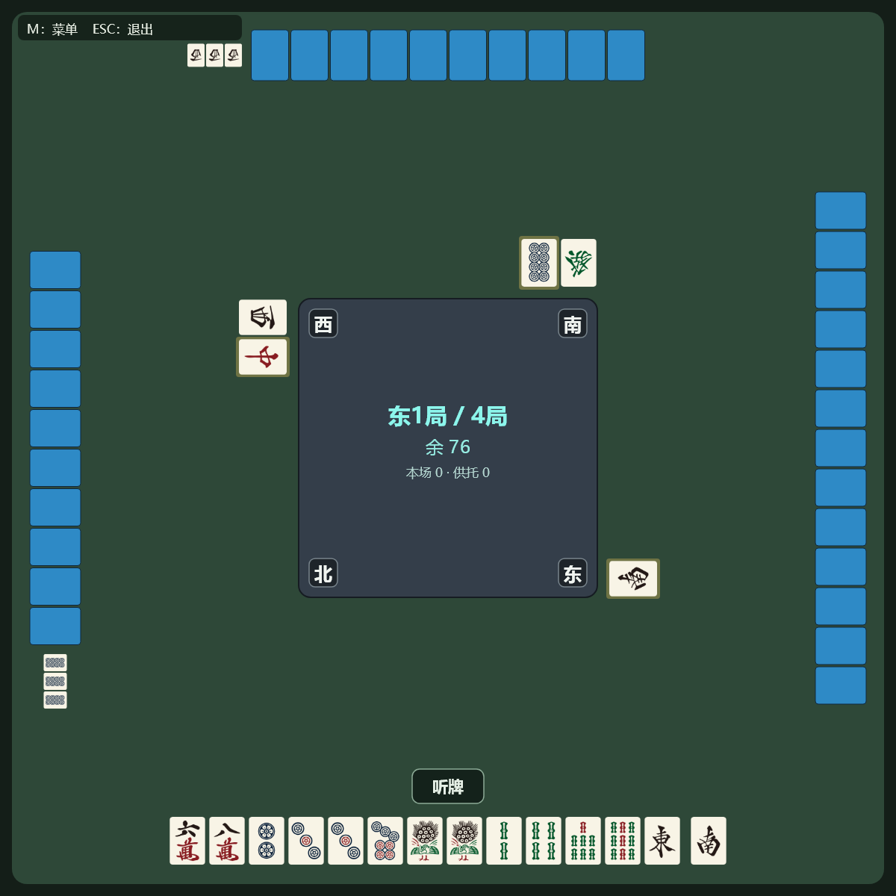
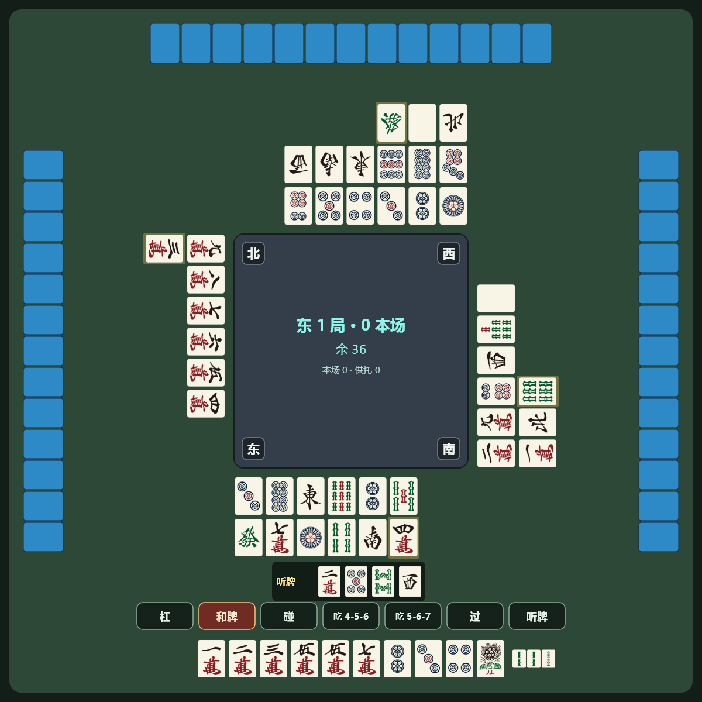
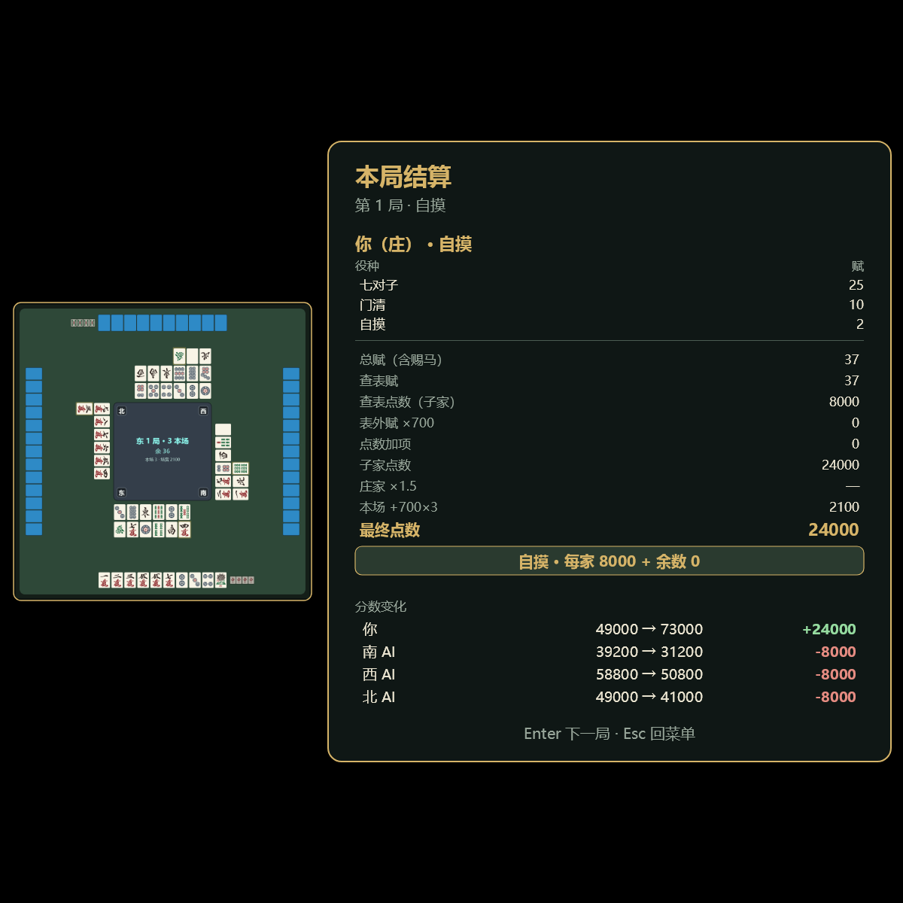

# 七子麻将 · C# 桌面版

七子麻将（Tiisu Mahjong）的 C# 桌面实现：Skia 自绘牌桌、后台引擎线程、四档人机 AI。

- 规则主仓（含完整规则书）：[Pub-Polaris/Tiisu-Mahjong-main](https://github.com/Pub-Polaris/Tiisu-Mahjong-main)
- 本仓是**桌面客户端**：把 Web 版的判役/引擎/AI 等价迁移到 C#，并重做成原生窗口程序



| 动作按钮 | 局末结算 |
|---|---|
|  |  |

## 当前状态

- 规则、判役、引擎与桌面玩法已可完整对局；全量测试 **270** 条。
- 已支持：报听/错和/场供、鼠标「下一局」、ESC 设置、规则速查、开源许可与参考鸣谢页。
- UI 已嵌入文渊圆体子集（重命名为 `Tiisu Rounded SC`，遵守 OFL 保留字体名）。
- 报牌语音不随包分发，首次使用时用本机 Windows SAPI 生成。
- 自博弈 v4 策略权重已接入，但**仅作参考/实验**，不代表棋力结论。

## 已实现

**规则与引擎**
- 判役：50 普通役 + 20 高役；`yaku-golden` 语料 0 差异
- 引擎状态机：回放事件逐字段 0 差异（吃碰杠/抢杠/多家和/流局/连庄）
- 计分：赋 → 阈值锚点 → 点数；庄家 1.5、本场 700/根、场赏 700×连庄、双和子、赐马
- 七对特殊形：四子七对（固定 7000）；九莲副露降级清一色
- 场供池：结算按 350 蓝筹取整，自摸余数进场供

**桌面程序**
- Skia 自绘 1200×1200 牌桌；GPU 渲染（`SKGLControl` + `GRContext`），无 GPU 自动回退 CPU
- 后台引擎线程 + 不可变快照；UI 只读快照，事件驱动（不轮询）
- 菜单 / 设置 / 局末结算；设置热更新
- 音效：程序合成；菜单 BGM；报牌语音本机生成
- 规则速查、开源许可全文、闭源参考鸣谢

**人机 AI**（`src/Tiisu.Engine/Ai/`）
- 四档：简单 / 普通 / 困难 / 修罗（MCTS，实验性、默认关）
- 向听数 + 进张 + 打点期望 + 放铳风险（现物/筋/壁/副露/残局）
- 不读别家手牌与牌山；同 seed 同决策；支持按座位锁定
- **7Neuu v4 自博弈策略网**：100,000 局自博弈训练，特征 339 维（除牌山外全部场况 + 牌型结构）；仅作参考，实际强度待对局评估

## 快速开始

**安装版**：运行 `dist/TiisuMahjong-Setup.exe`（由 `installer/build_installer.ps1` 生成），
安装到 `%LOCALAPPDATA%\Programs\TiisuMahjong`；需要 .NET 10 Desktop Runtime。

**源码运行**

```powershell
cd NET
dotnet build Tiisu.slnx
dotnet run --project src/Tiisu.App
```

无窗口自检命令（开发用）：

```powershell
dotnet run --project src/Tiisu.App -- --smoke-run 1 4          # 自走一场
dotnet run --project src/Tiisu.App -- --smoke-ai 1 4           # AI 档位与耗时
dotnet run --project src/Tiisu.App -- --smoke-call              # 报听规则
dotnet run --project src/Tiisu.App -- --smoke-call-flow 1 4     # 报听真实流程
dotnet run --project tools/Tiisu.DevTools -- --smoke-neural     # v4 策略网加载
dotnet run --project tools/Tiisu.DevTools -- --check-publish dist/publish
```

## 结构

```
NET\
  src\Tiisu.Core\      # 判役 / 计分（无 IO、无时间、无随机）
  src\Tiisu.Engine\    # 状态机 + AI（Ai/、SelfPlay/）
  src\Tiisu.App\       # WinForms 宿主 + Skia 绘制（Table/ Ui/ Runtime/）
  src\Tiisu.Updater\   # 替换式更新器（支持 --sha256）
  ml\                  # v4 自博弈训练脚本与权重（仅参考）
  tools\Tiisu.Tools\        # golden 重算 / 探针
  tools\Tiisu.AudioGen\     # 音效与语音生成（espeak-ng / SAPI）
  tools\Tiisu.DevTools\     # 发布自检 / 渲染 / 数据集导出
  tests\               # xUnit（Core / Engine / App / Updater）
  installer\           # NSIS 打包脚本
  docs\                # 规则参考、素材来源、自博弈、合规清单
```

## 质量门

```powershell
dotnet build Tiisu.slnx     # 0 警告 0 错误
dotnet test  Tiisu.slnx     # 270 条：Updater 7 / Core 62 / App 38 / Engine 163
```

golden 语料在 `tests/fixtures/`（`yaku-golden*.json`、`engine-golden.json`、`ai-golden.json`）。
`*.legacy.json` 是规则变更前的旧语料，仅作对比组，不参与测试。

## 第三方参考与合规

本项目在开发中做过外部技术研究，相关说明**随仓库公开**：

- [docs/REFERENCES.md](docs/REFERENCES.md)：技术参考说明
  - **Alice in Cradle**：仅调研空间音频架构；未使用其代码、Unity 中间件、素材或衍生产物
  - **明星三缺一 2002**：仅用 FFmpeg 分析包络/时长/密度；音效由本仓 `Tiisu.AudioGen` 独立合成，未使用原音频、代码或美术
  - **天凤 Tenhou**：仅作听牌形参考；未使用代码或数据
- [docs/ASSET-PROVENANCE.md](docs/ASSET-PROVENANCE.md)：全部美术/音频/字体素材来源
- [docs/ML-PROVENANCE.md](docs/ML-PROVENANCE.md)：v4 权重与训练数据来源
- [docs/SELFPLAY_TRAINING.md](docs/SELFPLAY_TRAINING.md)：自博弈数据/特征/奖励/训练
- [docs/RELEASE_COMPLIANCE.md](docs/RELEASE_COMPLIANCE.md)：发布合规检查清单
- [THIRD-PARTY-NOTICES.md](THIRD-PARTY-NOTICES.md)：第三方组件与许可证
- 游戏内「开源信息」：逐页列出全部组件 + 闭源参考鸣谢，可查看许可全文

### v4 权重声明

`ml/policy_weights_v4.json` 由本项目自博弈流程生成，**仅作参考/实验用途**：

- 它是「模仿自走 AI + 探索样本」的产物，不代表棋力已超过启发式 AI
- 也没有经过正式对局强度验证；若用于发布或比赛，请自行评估
- 训练数据不包含 MCR / Tenhou 等外部数据集；旧 v2 权重已移除

## 授权

代码采用 [MIT License](LICENSE)（与主仓 `Tiisu-Mahjong-main` 一致）。

- **字体**：文渊圆体 v1.110 子集，SIL OFL 1.1；已重命名为 `Tiisu Rounded SC`，许可证随包。
- **BGM**：`Assets/bgm/lobby.wav` 为 Kevin MacLeod《Parisian》，
  [CC BY 4.0](https://creativecommons.org/licenses/by/4.0/)，已作 -5 dB 调整；主菜单与许可页保留署名。
- **牌面**：`Assets/tiles.png` 来源 [lietxia/mahjong_graphic](https://github.com/lietxia/mahjong_graphic)，
  自由许可（可商用/修改/再分发）；许可全文随包。
- **音效**：`Tiisu.AudioGen` 合成，`ASSET-HASHES.md` 可复现。
- **报牌语音**：不随包分发；本机 Windows SAPI 生成。
- 完整清单见 [THIRD-PARTY-NOTICES.md](THIRD-PARTY-NOTICES.md) 与游戏内「开源信息」。

## 版本号

构建时自动从 git 取：`yymmdd-<短 hash>`（如 `261023-31f41c6`），工作区有未提交改动时追加 `+`。
主菜单右下角显示版本与作者。

## 关于七子麻将（摘自 Main 仓 README）

> 摘自 [Pub-Polaris/Tiisu-Mahjong-main](https://github.com/Pub-Polaris/Tiisu-Mahjong-main) 的 README 前两段，规则解释权归主仓。

七子麻将（Tiisu Mahjong／七子麻雀／Nanako Mahjong）是在国标麻将、立直麻将与川麻的基础上，融合大量自创役种与规则改良而形成的一种独立新规麻将。

它并非简单地混合既有规则，而是以“7赋起和”为基点，重新梳理了手牌价值的计算方式——用“赋”作为统一的计量单位，将番数逻辑替换为赋数累加，并在关键阈值上设置固定的点数锚点以方便快速进行基数性的计算。
