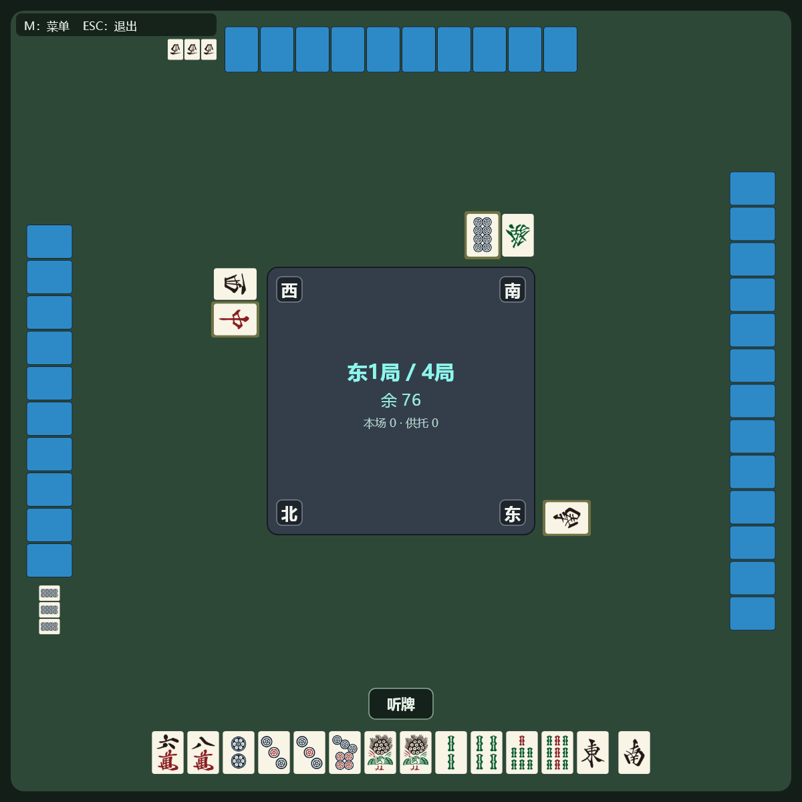
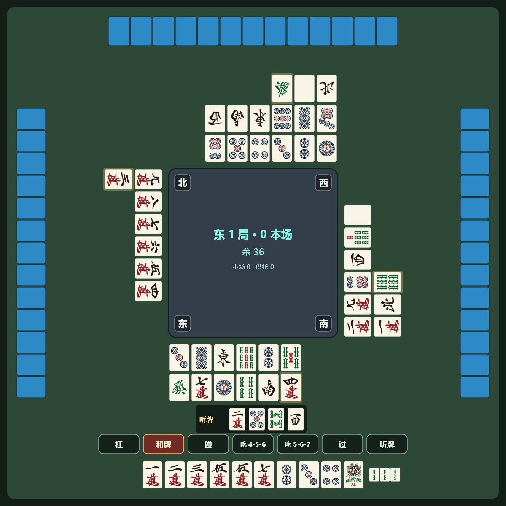
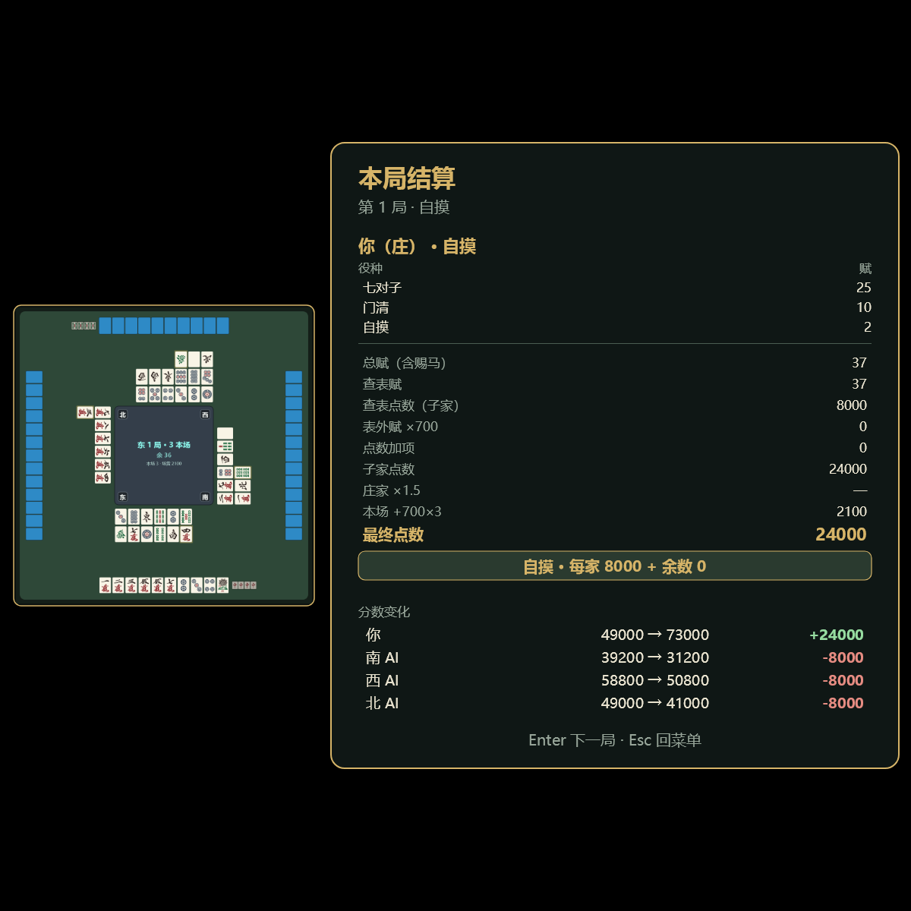

# 七子麻将 · C# 桌面版

七子麻将（Tiisu Mahjong）的 C# 桌面实现：Skia 自绘牌桌、后台引擎线程、四档人机 AI。

- 规则主仓（含完整规则书）：[Pub-Polaris/Tiisu-Mahjong-main](https://github.com/Pub-Polaris/Tiisu-Mahjong-main)
- 本仓是**桌面客户端**：把 Web 版的判役/引擎/AI 等价迁移到 C#，并重做成原生窗口程序



| 动作按钮 | 局末结算 |
|---|---|
|  |  |

## 已实现

**规则与引擎**
- 判役：50 普通役 + 20 高役；`yaku-golden` **10115 条 0 差异**
- 引擎状态机：705 事件回放逐字段 0 差异（吃碰杠/抢杠/多家和/流局/连庄）
- 计分：赋 → 阈值锚点 → 点数；庄家 1.5、本场 700/根、场赏 700×连庄、双和子、赐马
- 七对特殊形：四子七对（固定 7000）；九莲副露降级清一色

**桌面程序**
- Skia 自绘 1200×1200 牌桌；GPU 渲染（`SKGLControl` + `GRContext`），无 GPU 自动回退 CPU
- 后台引擎线程 + 不可变快照；UI 只读快照，事件驱动（不轮询）
- 吃/碰/杠/和/听牌全部可点击；键盘快捷键 H/P/C/K/Space/F/N/M/Esc
- 菜单 / 设置 / 局末结算（含牌桌缩略图）；设置热更新（局间存档 / 继续上局已整体停用）
- 音效：程序合成 + 中文报牌语音；菜单 BGM

**人机 AI**（`src/Tiisu.Engine/Ai/`）
- 四档：简单 / 普通 / 困难 / 修罗（MCTS，实验性、默认关）
- 向听数 + 进张 + 打点期望 + 放铳风险（现物/筋/壁/副露/残局）
- 不读别家手牌与牌山；同 seed 同决策；按权重 30/45/20/5 随机分配，支持按座位锁定

## 快速开始

**安装版**：运行 `dist/TiisuMahjong-Setup.exe`（由 `installer/build_installer.ps1` 生成），
安装到 `%LOCALAPPDATA%\Programs\TiisuMahjong`；需要 .NET 10 Desktop Runtime。

**源码运行**

```powershell
cd NET
dotnet build Tiisu.slnx
dotnet run --project src/Tiisu.App
```

无窗口自检命令（开发用）：

```powershell
dotnet run --project src/Tiisu.App -- --smoke-run 1 4          # 自走一场
dotnet run --project src/Tiisu.App -- --smoke-ai 1 4           # AI 档位与耗时
dotnet run --project src/Tiisu.App -- --smoke-call              # 报听规则（宣言 / 锁手 / 暗杠 / 错和）
dotnet run --project src/Tiisu.App -- --smoke-call-flow 1 4     # 报听真实流程（自动打一场并中途报听）
dotnet run --project src/Tiisu.App -- --render-screen out.png menu
dotnet run --project src/Tiisu.App -- --bench-gl 60            # GPU 基准
```

## 结构

```
NET\
  src\Tiisu.Core\      # 判役 / 计分（无 IO、无时间、无随机）
  src\Tiisu.Engine\    # 状态机 + AI（Ai/）
  src\Tiisu.App\       # WinForms 宿主 + Skia 绘制（Table/ Ui/ Runtime/）
  src\Tiisu.Updater\   # 替换式更新器
  src\Tiisu.Shell\     # 控制台自走壳（对拍用）
  tools\Tiisu.Tools\        # golden 重算 / 探针
  tools\Tiisu.AudioGen\     # 音效与语音生成（espeak-ng / SAPI）
  tests\               # xUnit（Api / Core / Engine）
  installer\           # NSIS 打包脚本
```

## 质量门

```powershell
dotnet build Tiisu.slnx     # 0 警告 0 错误
dotnet test  Tiisu.slnx     # Api 7 / Core 39 / Engine 105
```

golden 语料在 `tests/fixtures/`（`yaku-golden*.json`、`engine-golden.json`、`ai-golden.json`）。
`*.legacy.json` 是规则变更前的旧语料，仅作对比组，不参与测试。

## 版本号

构建时自动从 git 取：`yymmdd-<短 hash>`（如 `261023-31f41c6`），工作区有未提交改动时追加 `+`。
主菜单右下角显示版本与作者。

## 授权

代码采用 [MIT License](LICENSE)（与主仓 `Tiisu-Mahjong-main` 一致）。

**第三方素材**：`src/Tiisu.App/Assets/bgm/lobby.wav` 为 Kevin MacLeod 的《Parisian》
（[incompetech.com](https://incompetech.com/music/royalty-free/)），按
[CC BY 4.0](https://creativecommons.org/licenses/by/4.0/) 授权，随仓库分发；
已作 -5 dB 音量调整并循环播放。其余音效与语音均由 `tools/Tiisu.AudioGen` 程序生成。
完整清单见 [THIRD-PARTY-NOTICES.md](THIRD-PARTY-NOTICES.md)，主菜单底部也提供可点击署名。
